# 🌐 Awesome Digital Workplace Integration 

  
  
  
  
  
  

  

> 🚀 **A curated directory of enterprise Digital Workplace platforms, employee experience platforms (EXP), self-hosted intranets, ChatOps orchestration tools, and digital front doors.** 
> Benchmark commercial SaaS solutions alongside top open-source self-hosted alternatives with real-time star metrics, transparent pricing, and deployment architectures.

---

## 📑 Table of Contents

- [📊 Sector Overview & Market Dynamics](#-sector-overview--market-dynamics)
- [💼 SaaS & Hosted Enterprise Platforms](#-saas--hosted-enterprise-platforms)
- [🔓 Open-Source GitHub Projects](#-open-source-github-projects)
- [🏗️ Self-Hosted Architecture Blueprint](#️-self-hosted-architecture-blueprint)
- [🤝 How to Contribute](#-how-to-contribute)
- [💖 Support](#-support)
- [📈 Star History](#-star-history)
- [⚠️ Disclaimer](#️-disclaimer)

---

## 📊 Sector Overview & Market Dynamics

The global **Digital Workplace market** is valued between **$45 billion and $60 billion in 2025** and is projected to expand rapidly to **$75 billion to $100+ billion by 2026** (delivering a compound annual growth rate of **15% to 23%**).

The ecosystem demonstrates a pronounced **dual structure**:
- **Concentrated Enterprise Core**: At the foundation (enterprise productivity suites, cloud collaboration backbones, and enterprise service management), the market is heavily dominated by mega-caps like **Microsoft** (Microsoft Viva & Teams), **ServiceNow** (Employee Center), and **Salesforce** (Slack). High organizational switching costs, unified compliance certifications, and deep cross-platform bundling cement their strong market concentration.
- **Fragmented Specialist Layer**: Across specialized employee experience (EX), personalized front-line communication, AI virtual agents, and modern digital intranet hubs (e.g., Staffbase, LumApps, Simpplr), the market remains **moderately to highly fragmented**. Enterprises frequently pair a core platform layer with dedicated point solutions to serve specific frontline, mobile, or regional workforce engagement requirements.

---

## 💼 SaaS & Hosted Enterprise Platforms

The table below catalogs premier commercial digital workplace solutions sorted by company valuation/market cap in descending order, including concrete starting pricing and explicit free tier / trial criteria.

| Platform | Company Valuation / Revenue | Starting Pricing | Free Tier / Trial Limits | Description & Core Integrations |
| :--- | :--- | :--- | :--- | :--- |
| **[Microsoft Viva](https://www.microsoft.com/microsoft-viva)** | **~$3.9 Trillion** Market Cap (Microsoft) | **$2.00 / user / month** (standalone modules like Communications & Communities); full Viva Suite at **$12.00 / user / month** (annual commitment) | **30-day free trial** capped at **25 user licenses** for full suite evaluation; baseline Viva Connections included at no additional fee with qualifying M365 Business/Enterprise plans | **Employee experience platform (EXP)** embedded natively in Microsoft 365 and Teams. Integrates with Workday, SAP SuccessFactors, and ServiceNow for centralized tasks and feeds. **Best for**: Microsoft 365 organizations wanting native Teams and SharePoint intranet hubs. |
| **[Slack](https://slack.com/)** | **~$200 Billion** Market Cap (Salesforce; Slack ARR ~$2.5B–$3.0B) | **$8.75 / user / month** (Pro tier, billed monthly; $7.25 billed annually); Business+ at **$15.00 / user / month** | **Free-for-ever plan** with limits: **90-day message history**, up to **10 app integrations**, 1:1 audio/video huddles, and 5GB workspace file storage (no credit card required) | **Channel-based collaboration hub** with thousands of pre-built integrations for HRIS, ITSM, and dev tools. ServiceNow and Workday Everywhere offer conversational workflows natively in Slack. **Best for**: Dynamic workplaces seeking conversational collaboration with rich bot ecosystems. |
| **[ServiceNow Employee Center](https://www.servicenow.com/)** | **~$160 Billion** Market Cap (ServiceNow) | **~$60.00 / fulfiller user / month** (HRSD Foundation agent tier; requester employee portal access is typically bundled enterprise-wide) | **No public free tier or commercial free trial** (30-day enterprise evaluation sandboxes require sales engagement; permanent free Personal Developer Instances / PDIs available with inactivity hibernation for developer sandbox testing) | **Unified digital front door** that aggregates approvals, tickets, and knowledge across Workday, SuccessFactors, Jira, and enterprise systems into a single Integrated Action Center. Integrates with Teams and Slack. **Best for**: Global enterprises needing a single unified service portal across multi-system IT and HR backends. |
| **[Workday Everywhere](https://www.workday.com/)** | **~$52 Billion** Market Cap (Workday) | **~$8.00 – $42.00 / employee / month** (PEPM subscription model; typical enterprise contracts start at ~$100,000/year minimum) | **No free tier or free trial** for Workday HCM/Everywhere (guided interactive demos only; Workday Adaptive Planning offers a separate 30-day modeling free trial) | **Workday self-service embedded in Microsoft Teams and Slack**. Employees query leave balances, submit time off, and access payslips directly in chat channels without opening a browser. **Best for**: Workday customers surfacing employee self-service directly in daily communication channels. |
| **[Workvivo](https://www.workvivo.com/)** (Zoom) | **~$28 Billion** Market Cap (Zoom) | **~$20,000 / year** starting contract minimum (~$3.00 – $6.00 / user / month effective tier depending on headcount volume) | **No free tier or self-service free trial** (custom guided 1:1 live platform demo and proof-of-concept upon sales qualification) | **Employee communication and engagement platform** with social intranet feeds, peer recognition, and surveys. Acquired by Zoom to power modern hybrid workplace engagement. Integrates with Slack, Teams, Workday, and Google Drive. **Best for**: Organizations prioritizing company culture, social interaction, and employee recognition. |
| **[Moveworks](https://www.moveworks.com/)** (ServiceNow) | **$2.85 Billion** Valuation (Acquired by ServiceNow; >$100M ARR) | **~$15.00 – $45.00 / employee / year** (~$1.25 – $3.75 / employee / month, licensed across total company headcount; minimum contract typically starts at ~$90,000/year) | **No free tier or self-serve free trial** (evaluated exclusively via sales-led enterprise value assessment, pilot sandboxes, and guided technical POCs) | **Conversational AI employee support platform** unifying IT, HR, and facilities assistance natively across ServiceNow Employee Center, Slack, Teams, and Workday. Automatically resolves support issues in natural language. **Best for**: Enterprises wanting end-to-end autonomous resolution of employee requests. |
| **[Staffbase](https://staffbase.com/)** | **$1.1 Billion** Valuation (~$193M ARR) | **~$8.00 – $14.50 / user / month** (frontline-only employee packs start at lower tiered rates; minimum annual contracts apply) | **No free tier or public self-serve free trial** (custom sales-guided enterprise demo and tailored sandbox proof-of-concept upon request) | **Mobile-first intranet and internal communications platform** designed for both corporate desk workers and deskless frontline staff. Deep native integrations with Microsoft 365, Workday, and ServiceNow. **Best for**: Distributed enterprises with large frontline or mobile workforces. |
| **[LumApps](https://www.lumapps.com/)** | **$650 Million** Valuation (Acquired by Bridgepoint; >$150M combined ARR) | **~$8.00 – $25.00 / user / month** (tiered by company size, typically targeting 1,000+ seats on annual enterprise agreements) | **No free tier or public free trial** (custom product demonstrations and tailored sandbox pilots via sales team) | **Employee experience platform** with 100+ native connectors (Workday, SuccessFactors, ServiceNow, Slack, Teams, Google Workspace) and AI enterprise search. **Best for**: Global enterprises needing a multilingual, multi-system personalized hub. |
| **[Simpplr](https://www.simpplr.com/)** | **~$450 Million** Valuation (Private; Series D) | **~£4.00 (~$5.20) – $12.00 / user / month** (plus onboarding services, tiered for organizations with 500+ users) | **14-day free trial** available upon request through sales/demo qualification; no permanent free plan | **AI-powered modern intranet and EX platform** with automated content personalization and deep Workday, Okta, and Google directory synchronization. **Best for**: Mid-to-large organizations seeking an AI-driven, easy-to-manage intranet with automated governance. |
| **[Firstup](https://firstup.io/)** | **~$125 Million** Valuation (Private; >$100M ARR) | **~$12.00 – $20.00 / user / year** (~$1.00 – $1.70 / user / month, quote-based enterprise contract tied to workforce scale) | **No free tier or self-service free trial** (requires direct sales discovery, live demonstration, and tailored enterprise pilot) | **Workforce communications platform** built for targeted, multi-channel messaging orchestration across mobile, email, web, and digital signage. **Best for**: Large enterprises communicating with hard-to-reach frontline and distributed teams. |

---

## 🔓 Open-Source GitHub Projects

Explore the top self-hosted open-source software for team communication, digital intranet, knowledge bases, and workplace workflow integration. Repositories are equipped with live stargazer badges linking to their stargazers page and sorted in **descending order by GitHub Stars_Count**.

- **[Rocket.Chat](https://github.com/RocketChat/Rocket.Chat)** 
  - 📋 **Description**: An enterprise-grade, open-source communications platform (MIT License) that offers secure team messaging, omnichannel customer service, video conferencing, Matrix federation, and customizable workflow apps.
  - 🛠️ **Tech Stack**: TypeScript, Node.js, MongoDB, React, Electron, React Native.
  - 🚀 **Deploy**: Docker, Kubernetes, Helm, Snap, or Cloud SaaS.
  - 🎯 **Best For**: High-security, compliance-focused organizations (healthcare, financial services, defense) needing an air-gapped or self-hosted Slack/Teams alternative.

- **[Outline](https://github.com/outline/outline)** 
  - 📋 **Description**: Fast, modern, and intuitive team knowledge base and documentation platform (BSL 1.1 / AGPLv3) featuring real-time collaborative editing, granular permissions, Markdown support, and native Slack/Google/OIDC authentication.
  - 🛠️ **Tech Stack**: Node.js, React, TypeScript, PostgreSQL, Redis.
  - 🚀 **Deploy**: Docker, Kubernetes, or Outline Cloud.
  - 🎯 **Best For**: Modern product and engineering teams wanting a lightning-fast, self-hosted Notion or Confluence alternative for internal company wikis and SOPs.

- **[Mattermost](https://github.com/mattermost/mattermost)** 
  - 📋 **Description**: The leading open-source, self-hosted collaboration platform for technical and operational teams (MIT / AGPL). Provides secure 1:1 and group messaging, integrated Playbooks for incident response, and Board view for agile workflow tracking.
  - 🛠️ **Tech Stack**: Go, React, Redux, PostgreSQL / MySQL.
  - 🚀 **Deploy**: Docker, Kubernetes Operator, AWS, Helm, or Mattermost Cloud.
  - 🎯 **Best For**: Engineering and IT operations teams wanting a developer-friendly, Slack-compatible messaging backbone with automated DevOps/ChatOps playbooks.

- **[Nextcloud Hub](https://github.com/nextcloud/server)** 
  - 📋 **Description**: A comprehensive self-hosted content collaboration and productivity suite (AGPL-3.0) offering files synchronization, Nextcloud Office (real-time document editing), Nextcloud Talk (chat & calls), Calendar, Contacts, Mail, and Deck (Kanban).
  - 🛠️ **Tech Stack**: PHP, JavaScript, PostgreSQL / MariaDB / MySQL.
  - 🚀 **Deploy**: Docker, Snap, Kubernetes, Nextcloud AIO, or bare metal.
  - 🎯 **Best For**: Organizations prioritizing complete digital sovereignty and GDPR compliance to replace Google Workspace or Microsoft 365.

- **[Wiki.js](https://github.com/requarks/wiki)** 
  - 📋 **Description**: A powerful and extensible modern open-source wiki application (AGPL-3.0) built on Node.js. Features Markdown, visual WYSIWYG, and raw HTML editors, multi-lingual support, sync with Git repositories, and pluggable enterprise auth (LDAP, SAML, OAuth).
  - 🛠️ **Tech Stack**: Node.js, Vue.js, PostgreSQL / MySQL / SQLite / MSSQL.
  - 🚀 **Deploy**: Docker, Kubernetes, Heroku, or manual node runtime.
  - 🎯 **Best For**: IT departments and internal teams wanting a robust, searchable corporate documentation repository with bidirectional Git sync.

- **[Zulip](https://github.com/zulip/zulip)** 
  - 📋 **Description**: Powerful, open-source team collaboration software (Apache 2.0) that uniquely combines real-time chat with the asynchronous productivity of email threading. Every message belongs to a specific topic within a stream.
  - 🛠️ **Tech Stack**: Python (Django), TypeScript, PostgreSQL, Redis, RabbitMQ.
  - 🚀 **Deploy**: Docker, Kubernetes, Ubuntu / Debian scripts, or Zulip Cloud.
  - 🎯 **Best For**: Asynchronous, globally distributed teams who suffer from chat noise and need organized, searchable topic-based conversations.

- **[BookStack](https://github.com/BookStackApp/BookStack)** 
  - 📋 **Description**: Simple, self-hosted, easy-to-use platform for organizing and storing documentation and information (MIT License). Uses a familiar Book > Chapter > Page mental model with WYSIWYG and Markdown support.
  - 🛠️ **Tech Stack**: PHP (Laravel), MySQL / MariaDB, Blade templates, JavaScript.
  - 🚀 **Deploy**: Docker (LinuxServer), Ubuntu scripts, or manual PHP stack.
  - 🎯 **Best For**: Non-technical workforces and internal teams seeking an effortless, clean knowledge base that anyone can edit without a learning curve.

- **[Element (Matrix Web)](https://github.com/element-hq/element-web)** 
  - 📋 **Description**: A glossy, feature-rich web client (Apache 2.0) for the decentralized Matrix communications network, providing end-to-end encrypted messaging, voice/video conferencing, and cross-organization federation.
  - 🛠️ **Tech Stack**: TypeScript, React, Matrix JavaScript SDK.
  - 🚀 **Deploy**: Static web server, Docker, or desktop wraps.
  - 🎯 **Best For**: Decentralized organizations, government entities, and multi-tenant consortia requiring end-to-end encrypted federated workplace chat.

- **[Synapse (Matrix Server)](https://github.com/matrix-org/synapse)** 
  - 📋 **Description**: The reference home server implementation (AGPL-3.0) for the Matrix open standard for secure, decentralized, real-time communications. Powers cross-platform messaging, VoIP, and bridging to third-party tools.
  - 🛠️ **Tech Stack**: Python (Twisted / Asyncio), Rust, PostgreSQL.
  - 🚀 **Deploy**: Docker, Debian packages, Kubernetes Helm, Ansible.
  - 🎯 **Best For**: System administrators deploying a private, sovereign Matrix communication backbone for internal or inter-company collaboration.

- **[HumHub](https://github.com/humhub/humhub)** 
  - 📋 **Description**: An extensible open-source social network and intranet software (AGPL-3.0) designed for communication, community engagement, and file sharing. Features Spaces (group rooms), activity streams, user profiles, polling, calendar, and 80+ modular add-ons.
  - 🛠️ **Tech Stack**: PHP (Yii2 Framework), MySQL / MariaDB, jQuery.
  - 🚀 **Deploy**: Docker, cloud hosting, or shared hosting LAMP stack.
  - 🎯 **Best For**: Companies and educational institutions looking to build a private social intranet, staff directory, and internal community hub.

- **[Documize](https://github.com/documize/community)** 
  - 📋 **Description**: Modern, lightweight, open-source knowledge management software (AGPL-3.0) built on Go. Organizes content with spaces, templates, snippets, and document approval lifecycles.
  - 🛠️ **Tech Stack**: Go (Golang), Ember.js, PostgreSQL / MySQL / SQLite.
  - 🚀 **Deploy**: Single binary release, Docker.
  - 🎯 **Best For**: Lean IT and engineering departments requiring a fast, single-binary wiki and document approval workflow.

- **[Raven](https://github.com/The-Commit-Company/raven)** 
  - 📋 **Description**: Modern open-source team messaging platform built on the Frappe framework (AGPL-3.0). Tightly integrates with ERPNext and Frappe HR to embed document previews, task approvals, and HR notifications directly into chat.
  - 🛠️ **Tech Stack**: Python, Frappe Framework, React, React Native.
  - 🚀 **Deploy**: Self-hosted via bench, Docker, or Frappe Cloud.
  - 🎯 **Best For**: Enterprises running on Frappe and ERPNext who desire native ChatOps directly connected to their core ERP/HRMS workflows.

- **[TeamTalk](https://github.com/virjar/team-talk)** 
  - 📋 **Description**: Open-source instant messaging and workplace collaboration system (Multi-license) featuring multi-device synchronization, rich media file transfer, contact management, and end-to-end private server deployment.
  - 🛠️ **Tech Stack**: Kotlin Multiplatform, Ktor, Netty, PostgreSQL, RocksDB, Lucene.
  - 🚀 **Deploy**: Docker, JVM server containers.
  - 🎯 **Best For**: Developers and research teams seeking an extensible Kotlin-based messaging foundation for customized private office deployments.

- **[Farik](https://github.com/SamoTech/Farik)** 
  - 📋 **Description**: Lightweight open-source HR platform for small businesses (MIT License). Includes employee directory, leave management, recruitment pipelines, and internal helpdesk ticketing.
  - 🛠️ **Tech Stack**: Supabase (PostgreSQL), modern TypeScript, Next.js / React.
  - 🚀 **Deploy**: Vercel, Supabase self-hosted, or Docker.
  - 🎯 **Best For**: Startups and SMBs looking for a simple, zero-cost HR directory and internal helpdesk ticketing portal.

---

## 🏗️ Self-Hosted Architecture Blueprint

Organizations aiming to build a sovereign digital workplace without commercial vendor lock-in can assemble a multi-tier modular stack:

1. **Collaboration & Social Intranet Layer**: Deploy **[HumHub](https://github.com/humhub/humhub)** or **[Nextcloud Hub](https://github.com/nextcloud/server)** for company announcements, department spaces, and personal profile directories.
2. **Real-Time Communication Backbone**: Run **[Rocket.Chat](https://github.com/RocketChat/Rocket.Chat)**, **[Mattermost](https://github.com/mattermost/mattermost)**, or **[Zulip](https://github.com/zulip/zulip)** for chat, incident response, and bot automation.
3. **Knowledge Base & Wiki**: Deploy **[Outline](https://github.com/outline/outline)** or **[Wiki.js](https://github.com/requarks/wiki)** backed by OIDC / Keycloak single sign-on.
4. **Integration & Workflow Automation**: Connect systems using self-hosted automation tools (such as n8n or Apache Airflow) to sync events between self-hosted HR directories and chat channels.

---

## 🤝 How to Contribute

Contributions are warmly welcomed! Help make this the most complete, factual, and unbiased guide to digital workplace integration.

1. 🍴 **Fork the repository** on GitHub.
2. 🌿 **Create a new branch** (`git checkout -b feature/new-workplace-tool`).
3. 📝 **Add or edit entries** in `README.md`:
   - Follow the established formatting conventions (include name, repo/product URL, licenses, pricing, and key capabilities).
   - Ensure open-source entries include the correct shield stargazer badge linking to stargazers.
   - Maintain sorting order (descending by Stars_Count for OSS, descending by valuation for SaaS).
4. 🚀 **Commit your changes** with clear, descriptive commit messages.
5. 🔀 **Open a Pull Request** explaining your addition or revision.

---

## 💖 Support

If you find this repository valuable, please consider supporting the project:

- ⭐ **Star this repository** to help others discover it!
- 🍴 **Fork and share** with colleagues, devops teams, and IT leaders.
- ☕ **Buy me a coffee & support continuous updates**: Visit the [GitHub Sponsors Dashboard](https://github.com/sponsors/ishandutta2007) to help maintain and expand open-source directories.

Thank you to all contributors and community supporters! 🙌

---

## 📈 Star History

---

## ⚠️ Disclaimer

- **Community Curated**: This repository is a community-driven curated reference guide. It is independently maintained and does not represent an official endorsement of any vendor, commercial product, or open-source software listed.
- **Integration Layer vs. Point Solutions**: There is a critical architectural distinction between dedicated **Digital Workplace Integration Platforms** (such as Microsoft Viva or ServiceNow Employee Center, which connect cross-system HRIS/ITSM workflows) and adjacent point solutions (such as standalone chat apps or document wikis).
- **Security & Regulatory Compliance**: Enterprise workplace systems handle sensitive employee personally identifiable information (PII). Any implementation—whether SaaS or self-hosted—must strictly adhere to relevant privacy laws (GDPR, CCPA, HIPAA, SOC 2) with enforced multi-factor authentication (MFA) and audit trails.
- **Pricing Verification**: Commercial pricing, packaging tiers, and trial conditions are subject to continuous change by respective vendors. Always verify exact contractual rates directly with sales teams based on your specific headcount and deployment footprint.

---

  <b>Crafted with ❤️ for IT architects, software engineers, and digital workplace teams worldwide.</b> 
  Let's build a more transparent, connected, and employee-centric digital workplace.

